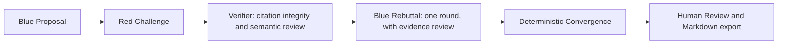
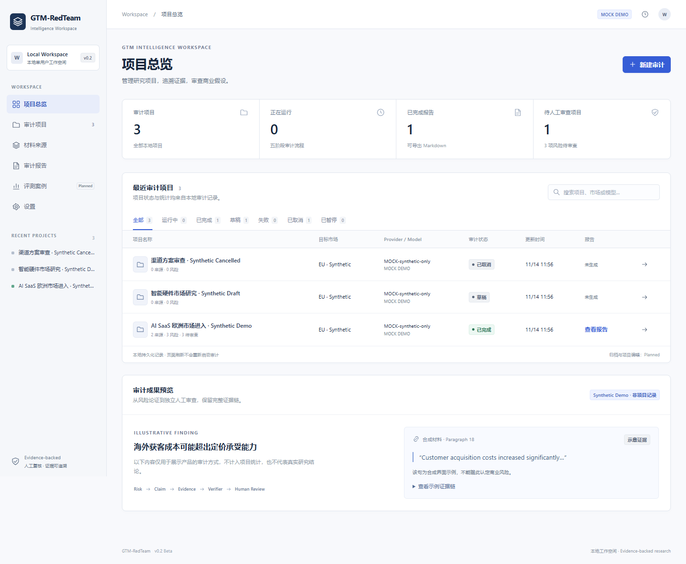
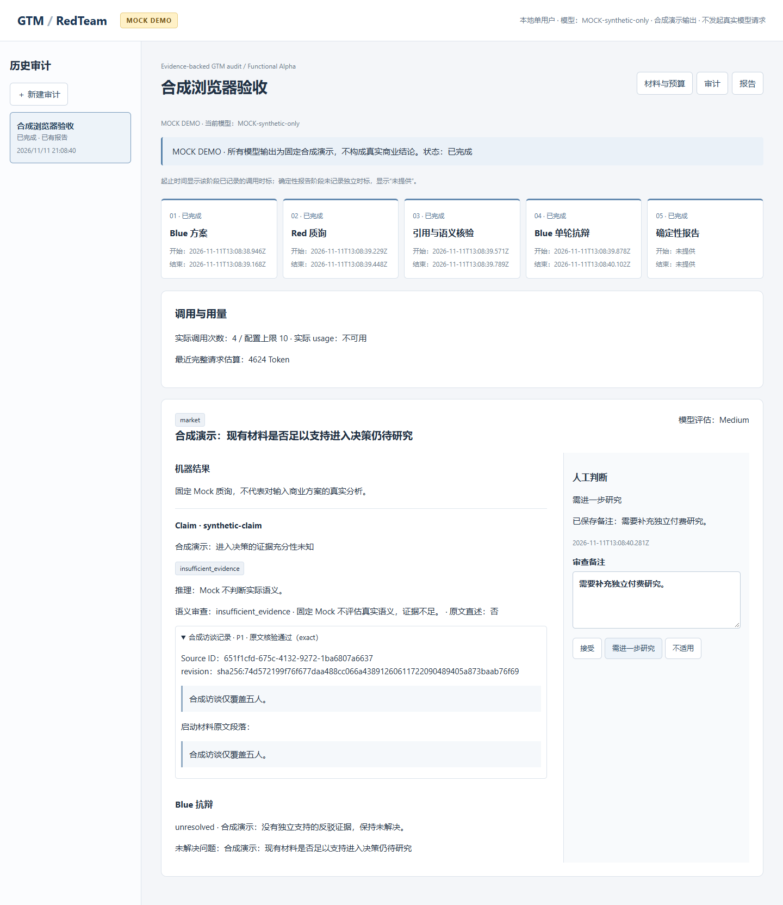
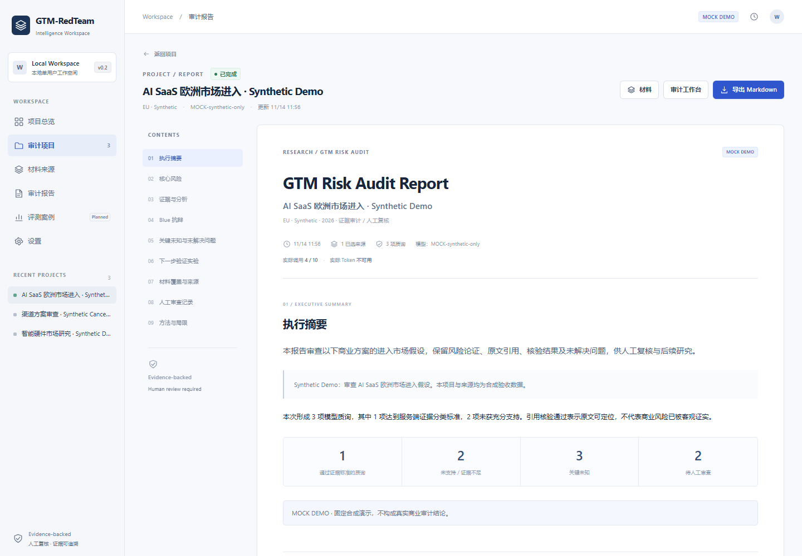

# GTM-RedTeam v0.1.0-alpha

**GTM-RedTeam — Evidence-backed Adversarial GTM Risk Audit**

An evidence-backed adversarial workflow for identifying unsupported assumptions, challenging GTM strategies, and producing traceable commercial risk assessments.

> **Validation status:** Mock engineering tests passed. On 2026-11-12, DeepSeek `deepseek-flash` completed one synthetic five-interview end-to-end smoke: **six real requests, all five business phases, a deterministic Markdown report, and 38,634 actual tokens recorded**. One Verifier truncation was repaired within the eight-call budget. This does not validate real commercial quality. See the [live validation record](docs/validation/deepseek-live-smoke-2026-11-12.md) and the separately preserved [first failed run](docs/deepseek-smoke-2026-11-12.md).

> **Alpha limits:** Local single-user only. TXT, MD and pasted text; no PDF/DOCX import, web research or RAG. No GPT baseline comparison, multi-case Benchmark, real-customer validation or paid-demand evidence. Token estimates are not supplier-calibrated.

**The model proposes. The verifier checks. The server decides. The human reviews.**

## Why this exists

Consulting analysts, international PMMs, strategy teams and early-stage investment analysts need to distinguish commercial facts from plausible stories. A fluent model answer may contain an invented quote, a real quote that does not support the conclusion, or fabricated CAC/LTV figures. Rechecking those claims is part of the work.

GTM-RedTeam structures that review: an initial GTM proposal, independent challenges, source checks, one rebuttal, and a deterministic report. It aims to make the evidence chain inspectable. It does not certify that a commercial risk is objectively true or claim better analysis than a general-purpose LLM.

## Workflow



The rebuttal verifier is an internal part of stage four, not a sixth business phase. No second Blue/Red round is run. Zero supported risks is a valid result.

## Evidence and decisions

- Each quote identifies a Source ID, material revision hash and paragraph ID.
- A deterministic continuous-substring check runs before narrowly defined normalization. Numeric, currency and unit meaning must be preserved.
- Semantic review separately judges whether evidence supports the claim and its reasoning. Quote existence alone proves neither relevance nor commercial risk.
- The server derives `material_fact`, `inference`, `hypothesis` or `insufficient_evidence`; model-supplied labels cannot override it.
- Sources and selection are frozen once started. Changing materials requires a new audit. Invalid citations stay out of verified evidence.
- Unknown CAC, LTV and other operating data must remain unknown. Human decisions and notes are stored separately from machine findings.

## Product and engineering decisions

| Mechanism | Implemented purpose |
| --- | --- |
| Citation Integrity / Evidence Traceability | Frozen source ID, revision and paragraph; deterministic quote checks and inspectable original text |
| Claim Classification | Server derives fact, inference, hypothesis or insufficient evidence from checked citations and semantic review |
| Prompt Injection Protection | Source and repair payloads are untrusted data; models cannot change schemas, roles, state or tool permissions |
| Budget Ledger / Finite State Machine | Reserve before dispatch, count repairs/failures, retain fourth-stage capacity, enforce five-phase progression |
| Human Review | Separate analyst decisions and notes alongside immutable machine findings |
| Deterministic Report Generation | TypeScript assembles the final report from validated records; model prose cannot replace it |

## Three screens

These screenshots show **synthetic Mock material and output**, not real commercial audit results.

| Prepare sources and budget | Inspect evidence and review | Read and export |
| --- | --- | --- |
|  |  |  |

The workbench shows mode, configured model, lifecycle, estimated tokens, actual usage, call count, citation checks, semantic review and classifications. Missing usage is **不可用 / unavailable**, never an estimate presented as actual usage. Stage timestamps use recorded call times; convergence has no independent start/end timestamps and shows “未提供”.

## Architecture and stack

React 19 + Vite + TypeScript; Express API; schema-validated local JSON persistence. The existing executor owns five-stage progression; the repository owns frozen records, atomic persistence and the shared request ledger. Both Providers use that executor and the same verifiers. Convergence and Markdown are generated by TypeScript, not a model.

See [architecture](docs/architecture/gtm-alpha.md), [API and provider boundaries](docs/provider-guide.md), and the retained [P1-B design](docs/architecture/gtm-redteam-p1b.md). SeminarRoom is the MIT-licensed predecessor; legacy modules and tests remain for provenance and regression coverage.

## Install and start

Requirements: Node.js >=20.19 and npm. Windows is the validated desktop environment. The GTM source is on the `codex/gtm-redteam-v0.1` branch; the repository name still reflects its SeminarRoom predecessor.

```sh
git clone --branch codex/gtm-redteam-v0.1 https://github.com/chengtaoxu23-prog/seminar-room.git gtm-redteam
cd gtm-redteam
```

Run from that repository root:

```sh
npm ci
npm run build
npm start
```

Open [the local workbench](http://127.0.0.1:4317). The server binds only to loopback. Without a GTM configuration file it uses offline Mock mode. Stop the terminal process to stop the service. Port 4317 must be free; do not terminate an unrelated service to free it.

For development: `npm run dev` (Vite on 5173, API on 4317).

## Offline Mock demo

Create an audit, add a clearly labelled synthetic TXT/MD or paste synthetic text, select whole sources, check the budget, then start Mock. Expand evidence, add Human Review, open the report, export Markdown and refresh. Mock uses fixed synthetic results and deliberately retains insufficient evidence / unresolved rebuttals. It cannot assess your market.

**材料可以保存，不代表一次审计能全部处理。** Default storage is 300,000 Unicode characters, material estimate budget 24,576 tokens, and complete request estimate budget 49,152 tokens. Whole sources are included or excluded. Nothing is silently truncated; every model request is checked again before dispatch.

## Real Provider configuration

Copy `.env.example` to `.env.gtm.local`, then edit that file locally. Do not paste keys into the browser, issue tracker or chat. GTM does not load the legacy `.env.local` file or reuse its OpenAI key automatically.

```dotenv
GTM_PROVIDER=openai-compatible
GTM_BASE_URL=https://api.deepseek.com
GTM_MODEL=deepseek-flash
GTM_API_KEY=fill-locally
GTM_MAX_CALLS=8
GTM_TIMEOUT_MS=60000
```

HTTPS is required except for a loopback HTTP endpoint. Credentials in URL/query strings are rejected. Only the server uses the key; config responses expose mode/model and limits, not credentials. `mock` is explicit offline mode; configuration and request errors in real mode never switch to Mock.

```sh
npm run check:gtm-config
```

This validates configuration and constructs the adapter with **zero network calls**. Restart `npm start` to use changed settings. Before starting a real audit, the UI requires informed agreement to send the business description, market, supplementary context and selected sources to the configured supplier.

One request times out after 60 seconds by default. Per-request input estimate is capped at 49,152 tokens. Output caps for new runtime audits: Blue 4,096; Red 16,384; Red Verifier 8,192; Blue Rebuttal 12,288; rebuttal Verifier 8,192. The environment template uses eight total calls, including repairs; the omitted-variable runtime default remains five for backward compatibility, and the global maximum is ten. Before the first Blue Rebuttal request, at least four calls must remain: up to two for generation and up to two for semantic verification. A smaller remaining budget stops the audit without dispatching the rebuttal. All registered calls, including failures and pending calls, occupy the same ledger. Estimated limits are not provider-calibrated counts.

### Approval-gated live smoke test

The recorded live smoke has finished. Any additional execution requires fresh explicit authorization and local configuration:

```sh
npm run smoke -- --approve-real-smoke
```

This performs one synthetic audit with **at most eight total dispatched requests, repairs included**. Expected model stages are Blue, Red, Red Verifier, Blue Rebuttal and rebuttal Verifier; stages may be skipped when no eligible evidence exists. Convergence makes no model request. If a repair consumes the cap, the run may fail without a report; it is not silently rerun. The command reports connection/workflow/usage outcomes, not analytical quality. Records and any report stay in ignored `data/`. Running it without the approval flag sends no request. See [provider guide](docs/provider-guide.md) before approving it.

## Tests

```sh
npm test
npm run typecheck
npm run build
npm run check:gtm-config
npm run test:e2e:gtm -- ./work/browser-evidence
```

The browser test needs Microsoft Edge at its standard Windows location, or a Chromium executable provided through `GTM_CHROMIUM_PATH`. Unit and integration tests use offline stubs/local test servers. A real-adapter stub test is not a live-model validation. Node's test summary includes parent containers; report independent leaf tests separately. Existing legacy test commands remain available but the GTM E2E command is the current workbench acceptance path.

## Security and privacy

Local data is **not encrypted**. The repository stores business inputs, raw source snapshots, model outputs, prompt snapshots, citations, ledger and human notes under ignored `data/`. Keep that directory private. Source material and model output are not written to debug logs. A supplier receives selected inputs only after a real audit is explicitly started; its privacy/retention policies are outside this workbench's control.

Never publish `.env*`, runtime data, local logs, cache, backups, ZIP/PATCH artifacts, or real business screenshots. `.env.example` is the only allowed environment template. Review [release safety](docs/release-safety.md) and run `npm run check:release` before staging. The scanner reports locations/types, not secret values; pattern scans cannot prove absence of every sensitive item. No accounts, remote hosting or multi-user access are supported.

## Limits and roadmap

Implemented: real adapter, own-material input, structured execution, deterministic citation checks/classification, evidence gaps, independent Human Review and export. Mock engineering coverage and one live synthetic workflow are verified separately. Live invalid-citation and insufficient-evidence branches remain untested; real analytical quality remains unverified. Interruptions use existing recovery behavior; no new automatic recovery is added. Earlier persisted report formats have not been migration-tested. Local data is not encrypted.

Future work, in priority order:

1. Validate multiple real commercial-material cases with permission.
2. Conduct a fair blinded comparison against a single-model GPT baseline.
3. Measure evidence-support quality and actual human verification time.
4. Collect real user feedback.
5. Decide further productization from those results.

See the preregistered [evaluation design](docs/evaluation-plan.md). These are plans, not achieved results. Paid demand, time savings and advantage over direct GPT use remain open questions. Deployment, broader parsing and collaboration are outside this alpha.

## License

[MIT](LICENSE). Retains SeminarRoom contributors' copyright and provenance. Dependencies retain their own licenses; see [third-party notices](THIRD_PARTY_NOTICES.md).

## 中文简介

GTM-RedTeam 是面向出海咨询分析师的证据型 GTM 审计工作台。它用固定五阶段、原文核验、独立语义审查、服务端分类和人工复核，让商业质询能够回到材料，或明确标注证据不足。当前为本地单用户 Alpha；Mock 已完成工程验证，DeepSeek 已用一个合成案例完成真实端到端冒烟（六请求、实际 38,634 Token），但真实商业质量、GPT 对比、多案例评测与付费意愿尚未验证。
