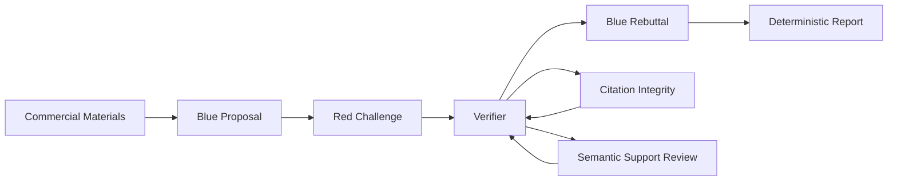

# GTM-RedTeam

### Evidence-backed Adversarial GTM Audit Workspace

**Make commercial assumptions inspectable. Make evidence traceable. Make unsupported reasoning visible.**

GTM-RedTeam is an evidence-first, adversarial AI workflow for auditing go-to-market (GTM) strategies. It combines structured, role-based adversarial reasoning, deterministic citation validation, semantic evidence review, and reproducible report generation.

Commercial arguments pass through a controlled sequence of proposal, challenge, verification, rebuttal, and report assembly. The current implementation uses fixed Blue/Red/Verifier roles with the configured provider; independent cross-model collaboration is not an implemented capability.

> The goal is not to build a smarter chatbot. It is to build a more auditable reasoning workflow.

---

## Why GTM-RedTeam?

General-purpose LLMs can generate persuasive commercial analysis while leaving important questions unanswered:

- Does the cited material actually exist?
- Does the source support the associated claim?
- Is the conclusion a fact, an inference, or an untested hypothesis?
- What happens when the opposing argument cannot be supported?
- Can another reviewer trace the reasoning back to the original material?

GTM-RedTeam addresses these problems through explicit evidence protocols and controlled execution.

## Core Architecture

### 1. Adversarial reasoning workflow



Five controlled stages:

| Stage | Responsibility |
|---|---|
| Blue Proposal | Develop a structured GTM proposal and identify commercial assumptions |
| Red Challenge | Challenge assumptions, identify risks and unsupported reasoning |
| Verifier | Check citation integrity and assess semantic support |
| Blue Rebuttal | Respond to challenges using available evidence |
| Deterministic Convergence | Assemble the final report using server-side TypeScript logic |

### 2. Two-layer evidence verification

**Layer 1 — Citation Integrity**

- Check continuous original substrings first, followed only by the fixed citation normalization rules.
- Preserve source IDs, paragraph IDs, and material revisions.
- Reject unsupported or fabricated citations.
- Keep source provenance inspectable.

**Layer 2 — Semantic Support Review**

- Assess whether the cited material supports the associated claim.
- Distinguish direct statements from inference and hypotheses.
- Preserve insufficient evidence instead of manufacturing certainty.
- Keep semantic judgments distinguishable from deterministic validation results.

A valid citation does not automatically establish a valid argument.

### 3. Structured Claim Classification

Claims are organized into four categories:

| Classification | Meaning |
|---|---|
| `material_fact` | Classified as directly stated in the cited material; source truth is not independently authenticated |
| `inference` | Reasoned interpretation based on available evidence |
| `hypothesis` | An assumption requiring further validation |
| `insufficient_evidence` | Available materials cannot support a conclusion |

Classification is governed by server-side rules using citation checks and model semantic review. Semantic support and directly-stated judgments remain model assessments subject to human review.

### 4. Deterministic Report Assembly

The model generates structured analytical outputs. TypeScript assembles the final report.

This separates probabilistic reasoning from deterministic report construction.

The system also incorporates:

- Shared model-call budgets.
- Request accounting and usage tracking.
- Explicit execution approval.
- Cancellation and failure handling.
- Human review records.
- Structured Markdown export.

---

## Product Capabilities

Current product capabilities include:

- Commercial project creation.
- TXT, Markdown, and pasted-text material ingestion.
- Source and material selection.
- Five-stage adversarial GTM workflow.
- Claim and citation validation.
- Semantic support review.
- Blue rebuttal.
- Human review.
- Deterministic report generation.
- Mock and real-provider execution modes.

## Current Validation Status

**Release:** `v0.2.0-beta.1`

The project has completed an initial engineering validation cycle.

### Verified engineering evidence

- 153 automated tests passed, alongside type checking and the production build.
- The complete Mock browser workflow and an extended multi-risk UI suite passed.
- Desktop, tablet and mobile layouts were checked.
- Real-provider synthetic end-to-end runs are recorded separately:

| Date | Provider / Model | Dispatched requests | Supplier-reported tokens | Outcome |
|---|---|---:|---:|---|
| 2026-11-14 | DeepSeek / `deepseek-flash` | 5 of at most 8 | 22,873 | Five phases completed, no repair attempt, deterministic report generated |
| 2026-11-12 | DeepSeek / `deepseek-flash` | 6 of at most 8 | 38,634 | Five phases completed; one Verifier truncation repaired within budget |

The latest live acceptance also checked REAL PROVIDER labeling, actual usage, independent Human Review, Markdown download and reload. Saved machine execution and the call ledger remained unchanged after review/reload.

See the [v0.2 live acceptance record](docs/validation/v02-beta-live-2026-11-14.md) and the [earlier live record](docs/validation/deepseek-live-smoke-2026-11-12.md). These runs used synthetic materials, not real commercial case studies.

### What this does not prove

- Commercial risk identification accuracy.
- Superiority over GPT or other general-purpose LLMs.
- Time savings or ROI.
- Reliability across different industries and document types.
- Willingness to pay.

The current release is a local, single-user Beta research workspace. It is available as downloadable source; a hosted multi-user SaaS is not delivered.

## Workspace and Demo

The product has three connected core screens:

| Project Hub | Audit Workspace | Report Center |
|---|---|---|
|  |  |  |

Screenshots contain labeled synthetic records. Project statistics are derived from saved records; the separate illustrative preview is excluded from those statistics.

Create an audit through four steps: commercial context, material ingestion, whole-source selection and budget review, then explicit confirmation. In the workspace, select a risk to inspect its Claims, original evidence, verification, rebuttal and independent review. The report has a nine-section table of contents and Markdown export. PDF export is not enabled.


Start with the included synthetic Mock Demo.

The synthetic example is intended to demonstrate the execution protocol, evidence relationships, and report structure. It is not a real commercial case study.

A reproducible public-source case study is planned for a future release.

## Quick Start

Requirements:

- Node.js >=20.19
- npm

```bash
git clone --branch codex/gtm-redteam-v0.2-ui https://github.com/chengtaoxu23-prog/seminar-room.git gtm-redteam
cd gtm-redteam
npm ci
npm run build
npm start
```

Open [http://127.0.0.1:4317](http://127.0.0.1:4317). The server binds only to loopback; the port must be free. Without local GTM configuration, the product uses explicitly labeled offline Mock mode.

The repository URL retains its SeminarRoom predecessor name. Its default branch now presents GTM-RedTeam. [Download the tagged Beta](https://github.com/chengtaoxu23-prog/seminar-room/releases/tag/v0.2.0-beta.1) for the fixed release snapshot. Windows is the validated desktop environment.

For development, run `npm run dev` (Vite: 5173; API: 4317).

### Real Provider Configuration

GTM-RedTeam supports an OpenAI-compatible Chat Completions provider.

Copy `.env.example` to `.env.gtm.local` and edit it locally. Example real-provider configuration:

```env
GTM_PROVIDER=openai-compatible
GTM_BASE_URL=https://api.deepseek.com
GTM_MODEL=deepseek-flash
GTM_API_KEY=<YOUR_API_KEY>
GTM_MAX_CALLS=8
GTM_TIMEOUT_MS=60000
```

Run `npm run check:gtm-config` to validate configuration without a model request, then restart the server. Real-provider errors do not fall back to Mock.

Never commit API keys, filled local environment files, runtime data or real-business screenshots. Data is stored locally without encryption. Selected commercial context and source materials are sent to the configured supplier only when a real audit is explicitly started; supplier privacy/retention policies are outside the workspace's control.

Real-model execution requires explicit approval. Failed and retried requests consume the shared call budget.

## Engineering Checks

```bash
npm test
npm run typecheck
npm run build
npm run test:e2e:gtm -- ./work/browser-evidence
npm run test:e2e:gtm:v02 -- ./work/v02-browser-evidence
```

Browser suites use Microsoft Edge at its standard Windows location, or a Chromium executable configured by `GTM_CHROMIUM_PATH`. They use isolated synthetic repositories and do not call a real model. Actual usage is recorded when returned; missing usage remains unavailable, never replaced by estimates.

Architecture: React, TypeScript, Vite, Express and local JSON persistence. See [UI architecture](docs/architecture/gtm-v02-ui.md), [provider guide](docs/provider-guide.md), [evaluation plan](docs/evaluation-plan.md), and [release safety](docs/release-safety.md).

## Current Limitations

- Local single-user execution.
- No account system, hosted service or collaborative workspace.
- Project editing/archiving, cross-project source reuse and evaluation management are not implemented.
- No UI resume action for paused audits; preserved records do not automatically authorize a replay.
- Primarily TXT, Markdown, and pasted-text ingestion.
- No production-grade PDF, Excel, or web-clipping pipeline yet.
- No controlled live external research integration.
- No persistent, multi-round hypothesis tracking.
- No formal GPT benchmark.
- No independently established commercial accuracy or ROI.

## Roadmap

The following version headings describe proposed product directions, not scheduled or completed releases. Real-case evaluation and analyst feedback should guide the scope of each phase.


### v0.3 — Persistent Commercial Hypothesis Tracking

- Structured hypothesis registry.
- Versioned source and evidence records.
- PDF and spreadsheet ingestion with source locators.
- Evidence-supported and evidence-challenged state transitions.
- Human-approved hypothesis updates.
- Longitudinal research history.

### v0.4 — Controlled External Evidence

- External source collection.
- Retrieval timestamps and source snapshots.
- Source provenance and quality metadata.
- Conflicting evidence detection.
- Evidence updates linked to existing hypotheses.

### Future — Evaluation and Research Workspace

- Reproducible public-source case studies.
- Blind comparisons against general-purpose LLM baselines.
- Multi-case evaluation datasets.
- More advanced research workflows.

### Long-term — Team Research and Delivery

- Persistent research projects linking hypotheses, evidence, validation work and re-audits.
- Team review, permissions and isolated client workspaces.
- Reliable task recovery, backups and hosted operation.
- Reviewable report sharing and reliable professional export formats.

Roadmap items are planned capabilities, not completed features. Commercial quality, efficiency and willingness to pay require separate evidence.

## Engineering Principles

1. Preserve the original source.
2. Never confuse citation existence with semantic support.
3. Keep facts, inferences, and hypotheses distinguishable.
4. Never manufacture missing evidence.
5. Keep model reasoning separate from deterministic validation.
6. Preserve human review and audit history.
7. Make execution budgets and limitations visible.

## License

MIT License.

See [LICENSE](LICENSE) for details. The project retains the MIT-licensed SeminarRoom predecessor copyright and provenance. Dependencies retain their own licenses; see [third-party notices](THIRD_PARTY_NOTICES.md).

---

**GTM-RedTeam is an ongoing engineering and product research project.**

Its central question is simple:

*How can we make AI-generated commercial reasoning easier to challenge, verify, and trust?*
