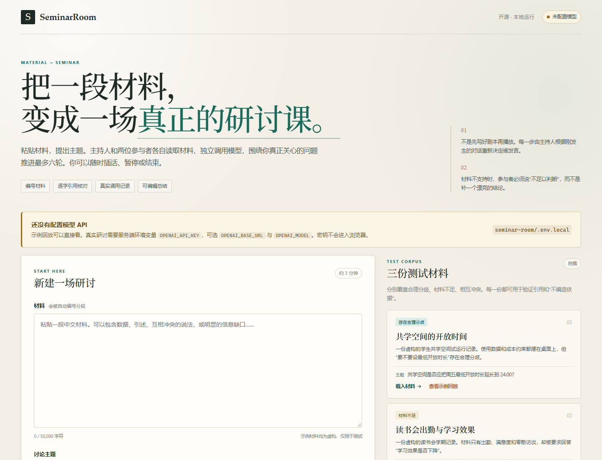
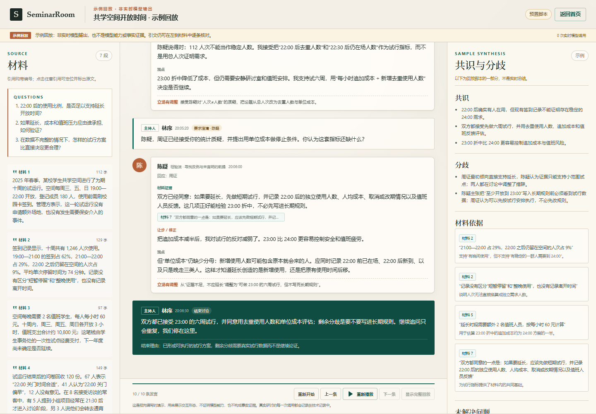

# SeminarRoom

> 把一段材料，变成一场可参与、可暂停、可核对引用的 AI 研讨课。

SeminarRoom 是一个以教学研究为首个内置产品的早期可用版（Alpha）：用户粘贴中文材料，系统自动编号分段并生成三个讨论问题；主持人、参与者 A、参与者 B 通过**独立的模型上下文**和结构化消息交接，进行最多六轮研讨；用户可以随时插话、暂停、继续或结束，最后得到可编辑的共识、分歧、材料依据与未解决问题，并导出 Markdown / JSON。



**项目阶段：早期可用版（Alpha），目前已能运行真实研讨。** 面向短材料阅读与讨论；需要在本机运行，并自行配置模型 API。项目使用 AI 编程工具辅助实现。独立复验结果与能力边界见 [发布状态](docs/release-status.md)。

快速了解：[产品与设计](docs/product.md) · [测试证据](docs/test-record.md) · [演示脚本](docs/demo-script.md)。

配置模型后，相关材料与讨论内容会发送给你选择的模型服务商；会话保存在本机。

> **交付状态（重要）**
>
> 核心流程、引用核对、暂停/结束、保存/导出、示例回放已经实现，并通过 8 项自动化测试与一轮浏览器端到端测试。浏览器 E2E 使用本地测试替身（`scripts/mock-openai.mjs`），**不是真实模型**。
>
> 2026-11-07，使用千问 `qwen-plus`（`dashscope.aliyuncs.com`）完成书法教学备课研讨：“一节90分钟毛笔书法入门课，如何兼顾看清示范、动手练习与个别反馈？”实际运行 **6轮、14次模型调用、42,495 tokens**（输入37,444，输出5,051），包含用户插话、参与者直接回应、独立总结、人工编辑保存及 Markdown / JSON 导出。
>
> 这是一次人工操作的真实运行案例，不等于 `npm run check:live` 自动化实模验收通过；目前仍未生成该脚本的 `docs/live-run.json` 报告。案例没有验证真实模型下的暂停/继续、长期稳定性、教学效果或多模型协作。三角色使用同一个模型和同一套服务配置，通过独立上下文分别调用。 详见[当前发布状态](docs/release-status.md)和[测试记录](docs/test-record.md)。HANDOFF 与旧截图中的“无密钥／未验证”描述属于最初交付状态，不代表当前无真实运行案例。

## 目录

- [产品定位与发展方向](#产品定位与发展方向)
- [它解决什么问题](#它解决什么问题)
- [已实现的能力](#已实现的能力)
- [快速开始](#快速开始)
- [模型配置](#模型配置)
- [使用流程](#使用流程)
- [三个角色如何独立工作](#三个角色如何独立工作)
- [引用、材料与背景知识](#引用材料与背景知识)
- [暂停、结束与失败](#暂停结束与失败)
- [保存与导出](#保存与导出)
- [示例回放](#示例回放)
- [限制与边界](#限制与边界)
- [自测](#自测)
- [项目结构](#项目结构)
- [参考与许可](#参考与许可)

## 产品定位与发展方向

**教学研究是 SeminarRoom 的第一个内置产品**，当前通过材料、三问、三角色研讨和总结导出这条通用流程，服务教学备课与方案比较；尚没有独立的教学研究模板或专用模块。

多 API Key、多模型协作、自主分工、共同研究与写作、界面优化是未来发展方向，尚未实现或验收。当前的主持人调度是既定角色内的发言安排，不代表 Agent 已能自主组建团队、分解研究任务或联合写作。

## 它解决什么问题

普通的“和文档聊天”通常只有一条对话、一个回答。真实研讨需要的是：

- 一个主持人决定下一步：先问什么、让谁回应、何时收束；
- 两个视角不同的参与者，各自读材料、互相回应，而不是轮流复述；
- 用户随时打断，主持人必须重新安排，而不是继续播放预写剧本；
- 每一个材料引用都能回到真实段落；
- 讨论结束后，总结里的共识、分歧和依据可以核对、可以编辑。

SeminarRoom 只做这条主路径。它不做课件、白板、语音、数字人或多人课堂。

## 已实现的能力

| 能力 | 实现 |
| --- | --- |
| 材料编号分段 | 保留原文，按空行/长段拆分，生成稳定的 `材料 1..N` 编号 |
| 三个讨论问题 | 一次真实“备课主持人”调用；用户可编辑，最多 120 字/题 |
| 真实三角色编排 | 主持人、参与者 A、参与者 B 分别组装上下文并独立调用模型 |
| 工具读取材料 | `read_material(ids/query)`，Agent 可以按编号或关键词读取原文，技术记录显示工具调用 |
| 引用核对 | 引文必须是某个编号段落中的逐字连续子串；无效引用被隐藏并显示警告 |
| 背景知识区分 | `background` 块标成“模型背景 · 非材料”，强制移除其材料引用 |
| 用户插话 | 加入待回应队列；主持人必须把用户消息 ID 放进安排，参与者必须直接回应 |
| 暂停 / 继续 | 暂停后不再调度新调用；进行中的一次调用结束后停止，继续时由主持人重新决定 |
| 结束 | 用户结束会中止进行中的调用；之后只允许独立的“总结员”调用 |
| 总结 | 共识、分歧、材料依据、未解决问题；可编辑并保存 |
| 本地保存 | 服务端 JSON 持久化，刷新后可按 URL 恢复 |
| 导出 | Markdown 和技术记录、完整 JSON |
| 示例回放 | 一条预先编写的回放，明确标注“非实时模型输出” |
| 技术记录 | 每次请求的角色、用途、状态、耗时、token、工具调用、上下文指纹、错误 |
| 硬上限 | 轮次、调用数、输出 token、请求超时，均由环境变量配置 |

## 快速开始

要求：Node.js **>= 20.19**，npm（仓库包含 `package-lock.json`）。

```bash
git clone https://github.com/chengtaoxu23-prog/seminar-room.git
cd seminar-room
npm ci
cp .env.example .env.local      # Windows PowerShell: Copy-Item .env.example .env.local
# 编辑 .env.local，填入服务端模型配置
npm run dev
```

打开：

- 前端开发地址：<http://127.0.0.1:5173>
- API：<http://127.0.0.1:4317>

生产构建：

```bash
npm run build
npm start
# http://127.0.0.1:4317
```

`npm start` 需要先构建；它会把 `dist/web` 作为静态站点提供，服务只绑定 **127.0.0.1**。

### 没有密钥可以先看什么

- 首页三份测试材料可以载入表单，但真实研讨按钮会被禁用；
- 点击“查看示例回放”可以看完整的交互脚本；
- 示例回放明确标为“非实时模型 / 预置脚本”，不会产生调用，也不会伪造技术记录。

## 模型配置

SeminarRoom 使用一个 OpenAI 兼容的 `/chat/completions` 接口。密钥只在 Node 服务端读取，浏览器拿不到，也不会写入日志、`localStorage` 或仓库。

`.env.local`：

```dotenv
OPENAI_API_KEY=your-server-side-key
OPENAI_BASE_URL=https://api.openai.com/v1
OPENAI_MODEL=gpt-4o-mini
```

也支持 DeepSeek 等兼容服务：

```dotenv
OPENAI_API_KEY=...
OPENAI_BASE_URL=https://api.deepseek.com/v1
OPENAI_MODEL=deepseek-chat
```

如果 `OPENAI_BASE_URL` 已经以 `/chat/completions` 结尾，会直接使用；否则自动追加。

| 变量 | 默认值 | 说明 |
| --- | --- | --- |
| `OPENAI_API_KEY` | 空 | 必填；缺失时 `/api/health` 显示未配置，真实研讨不可用 |
| `OPENAI_BASE_URL` | `https://api.openai.com/v1` | OpenAI 兼容 API 根地址 |
| `OPENAI_MODEL` | `gpt-4o-mini` | 模型名称 |
| `SEMINAR_PORT` | `4317` | 本地服务端口；绑定地址固定为 `127.0.0.1` |
| `SEMINAR_MAX_ROUNDS` | `6` | 1—6 轮，超过六轮不允许 |
| `SEMINAR_MAX_CALLS` | `30` | 所有模型请求上限，含问题生成、工具续调、校验修复和总结 |
| `SEMINAR_MAX_OUTPUT_TOKENS` | `700` | 单次输出上限 |
| `SEMINAR_REQUEST_TIMEOUT_MS` | `60000` | 单次请求超时 |
| `SEMINAR_TEMPERATURE` | `0.55` | 0—1.5 |
| `SEMINAR_DATA_DIR` | `./data/sessions` | 会话 JSON 保存目录 |

> 模型需要支持工具调用（`tools` / `tool_calls`）和较稳定的 JSON 输出。SeminarRoom 会解析 JSON、对结构错误做一次修复调用、对引用逐字核对；它不能保证任意模型都稳定遵循格式。

## 使用流程

1. 粘贴中文材料，填写主题。材料会自动编号分段。
2. 点击“生成三个问题”。这是一次真实调用；生成后进入确认页，三个问题都可以修改。
3. 点击“开始研讨”。主持人先决定开场和第一位发言人。
4. A / B 各自读取相关材料段落，可以调用 `read_material` 查更多原文，然后输出结构化发言。
5. 用户随时可以在底部插话。主持人下一步必须优先安排相关参与者直接回应用户，而不是继续原计划。
6. 主持人可以继续提问、要求澄清或结束；达到六轮也会自动结束。
7. 结束后，独立的总结员生成可编辑总结；你可以修改共识/分歧/未解决问题，并保存。
8. 用 Markdown 或 JSON 导出完整记录。

## 三个角色如何独立工作

没有“一次调用生成全部剧本”。

```
主持人调用
  → 结构化 HostAction: invite / clarify / end
  → 若 invite：把 publicMessage 显示给用户，把 prompt / focus / 回应对象交给一位参与者
参与者调用
  → 独立组装上下文（角色设定、自己的立场、相关材料、近期讨论、待回应内容）
  → 输出结构化 blocks + citations + addresses
  → 回到主持人，由主持人重新决定下一步
```

- **主持人**拿到材料索引、三个问题、角色表、待回应用户消息和最近发言；需要原文时可调用工具。
- **参与者**拿到与其任务相关的材料段落、自己的前几次发言、近期讨论、主持人的具体任务、要回应的消息；不拿到另外两位角色的“系统提示”。
- **总结员**是独立调用，只整理实际发生的讨论和材料原文，不再扮演角色。
- 每次调用都有自己的 `contextHash`，在“技术记录”中可以看到三种角色互不相同的上下文指纹。
- 代码不会把一次模型输出拆成三条假消息，也不会用延时动画伪装实时协作；技术记录中的每次请求都来自 `server/seminar.ts` 的真实调用。

### 结构化交接

主持人 JSON：

```json
{
  "action": "invite",
  "participantId": "a",
  "publicMessage": "……",
  "prompt": "给参与者的具体任务，不替对方写答案",
  "focus": "本轮聚焦点",
  "addressUserMessageIds": [],
  "respondToMessageIds": [],
  "reason": "为什么这样安排",
  "endReason": null
}
```

参与者 JSON：

```json
{
  "blocks": [
    {
      "type": "evidence",
      "text": "……",
      "citations": [{ "paragraphId": 2, "quote": "逐字原文" }]
    }
  ],
  "addresses": ["要直接回应的消息 id"],
  "stanceUpdate": { "changed": false, "note": "" }
}
```

服务端会校验字段、引用、消息 ID 和状态规则；失败会做一次修复调用，仍失败则进入可见的错误状态，而不是伪造成功。

## 引用、材料与背景知识

- 材料被编号；界面左侧是原文。
- 参与者只能引用真实存在的段落编号。
- `quote` 必须是该段落中的**逐字连续子串**；使用省略号、改写或跨段拼接都会被判为无效。
- 无效引用会从消息中隐藏，并把标为“材料证据”的块降级为“观点”；界面显示核对提示。
- 点击“材料 N”会滚动到左侧对应段落并高亮引文。
- `background` 块统一显示为“模型背景 · 非材料”，且不接受材料引用。
- 总结中的材料依据也会再次逐字核对；核对不通过的条目会被移除。

这保证的是“引用确实来自原文”，而不是“观点一定正确”。AI 研讨仍然只是观点演练，不是事实裁决。

## 暂停、结束与失败

| 操作 | 行为 |
| --- | --- |
| 暂停 | 设置 `stage=paused`；当前进行中的一次请求可以结束并写入结果，但之后不再调度任何新的主持/参与者调用 |
| 继续 | 由主持人重新读取当前状态，决定下一步，不恢复固定剧本 |
| 用户插话 | 进入 `pendingUserMessageIds`；下一次主持人安排必须包含用户消息 ID；参与者输出 `directToUser=true` 并在界面标注“直接回应你” |
| 结束 | 设置 `stage=ended`，中止进行中的请求；不再有新的角色调用，只允许一次独立总结调用 |
| 调用失败 | 记录错误、请求状态和可见错误横幅；可重试；失败不会被显示为成功 |
| 达到轮次/调用上限 | 停止并生成已有总结；技术记录显示停止原因 |

默认最多 6 轮；每一轮是一次“主持人 + 一位参与者”的交接。调用数达到上限前会预留一次总结调用。

## 保存与导出

- 每次状态变化写入服务端 `data/sessions/<session-id>.json`。
- 会话 ID 写入 URL（`?session=...`）与浏览器 `localStorage`；刷新会自动读回。
- “保存”不需要手动点击：服务端持续保存，界面显示最后保存时间。
- 总结编辑点击“保存编辑”后写回服务端。
- 导出：
  - `GET /api/sessions/:id/export.md`
  - `GET /api/sessions/:id/export.json`
- 导出内容直接来自服务端实际会话状态，包含技术记录和编辑后的总结；不包含 API 密钥、原始提示词或模型响应体。
- JSON 是完整状态；Markdown 是便于阅读的记录。

## 示例回放

示例回放位于 `examples/replay.ts`，使用虚构材料《共学空间的开放时间》。

- 明确标注“示例回放 · 非实时模型输出”；
- 页面显示“预置脚本 / 0 次实时模型调用”；
- 不生成技术调用记录，避免伪造；
- 用户插话是脚本的一部分，展示“先回应用户”的交互形态；
- 总结是预先编写的示例，不是模型输出。



## 限制与边界

- 单用户、本地单进程；没有登录、权限或多人协作。
- 会话存放在本地 JSON 文件，不是数据库；不适合公网部署。
- 没有 PDF、图片、音频/视频、语音、联网搜索、数字人、云同步。
- 前端使用轮询刷新（约 1 秒），不是 SSE/WebSocket。
- 模型生成的结论不是事实；引用核对只验证“原文是否真的存在”。
- 工具调用要求所选模型支持 OpenAI 风格的 `tools`。
- 项目不估算费用；只记录接口返回的 token 用量；未返回时显示“接口未返回”。
- 质量取决于模型对中文、JSON、工具调用和引用指令的遵循程度。

## 自测

```bash
npm run typecheck
npm test
npm run build
```

当前结果见 [docs/test-record.md](docs/test-record.md)。

真实模型验收（需要服务端已配置可用密钥）：

```bash
npm start              # 终端 1
npm run check:live     # 终端 2
```

`check:live` 会拒绝把 `mock/fake/e2e` 模型当作真实模型，并写出不包含密钥的 `docs/live-run.json`。

浏览器端到端测试使用测试替身，命令见测试记录；该测试只证明 UI 与 API 流程，不证明真实模型能力。

## 项目结构

```
seminar-room/
├── server/
│   ├── index.ts          # 绑定 127.0.0.1 的 Node 入口
│   ├── routes.ts         # HTTP API
│   ├── seminar.ts        # 编排、预算、暂停/结束、总结、工具循环
│   ├── prompts.ts        # 三角色与总结提示
│   ├── validation.ts     # JSON 结构、引用逐字核对
│   ├── store.ts          # 本地 JSON 持久化
│   ├── export.ts         # Markdown / JSON 导出
│   └── config.ts         # 环境变量与硬上限
├── src/shared/           # 前后端共享类型、分段与检索
├── web/                  # React + TypeScript 界面
├── examples/             # 三份自撰材料、示例回放
├── tests/                # Node test 单元/编排测试
├── scripts/              # mock E2E、visual check、真实模型验收
├── docs/
│   ├── product.md        # 产品与设计说明
│   ├── demo-script.md    # 约 90 秒演示脚本
│   ├── test-record.md    # 实际测试记录
│   └── screenshots/
├── HANDOFF.md
├── .env.example
├── package.json
└── package-lock.json
```

## 参考与许可

SeminarRoom 的概念参考了 [THU-MAIC/OpenMAIC](https://github.com/THU-MAIC/OpenMAIC)（MIT License，Copyright (c) 2026 THU-MAIC）的多 Agent 课堂与材料工具机制，但**没有复制其代码**，也不是其精简分支。

本仓库代码使用 MIT License，见 [LICENSE](LICENSE)。

产品取舍、资料使用、参考来源和设计决策见 [docs/product.md](docs/product.md)。
