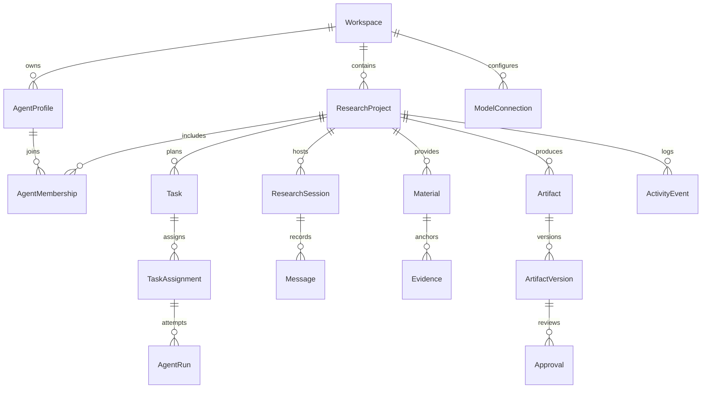

# 核心领域模型与兼容契约
2026-11-08 · V1.2。下列为目标模型，除SeminarSession现有字段外均不是后端实现事实。

## 对象、关键字段、约束
全局ID采用不含个人信息的稳定opaque ID（可用UUID）；显示短号另存，不能以数组下标为ID。所有对象有createdAt/updatedAt；可变实体有revision以支持乐观并发，时间为UTC，界面按用户时区显示。

| 对象 | 最小字段 | 不变量 / 归属 |
|---|---|---|
| Workspace | id,name,locale,timeZone | 单机默认空间；后续认证独立加，不隐含多人已实现 |
| ResearchProject | id,workspaceId,title,goal,status | 长期容器；draft/active/archived；不从单场会话推算百分比 |
| AgentProfile | id,workspaceId,name,avatarSpec,style,revision | 机器人身份；改名换模型不换ID |
| AgentMembership | id,projectId,agentId,responsibility,permissions,connectionBinding | 项目职责/权限；不反写历史执行快照 |
| ModelConnection | id,workspaceId,providerId,adapterId,baseUrl,configuredModel,capabilities,testResult | 公共DTO不含密钥；credentialRef仅服务端，浏览器只见hasCredential |
| ResearchSession | id,projectId?,legacySessionId?,roleSnapshots,connectionSnapshots | 一次研讨；保留schema-v1真源，快照为非敏感信息 |
| Task | id,projectId,goal,status,dependencyIds,inputRefs,acceptance,stopPolicy | 工作单元，完成需验收；不等于一次运行 |
| TaskAssignment | id,taskId,agentMembershipId,assignedAt,supersededAt? | 指派有历史；改owner不改既有Run |
| AgentRun | id,taskId,assignmentId,agentId,attemptNo,idempotencyKey,state,inputVersionRefs,outputRefs,error,usage | 一次尝试；agentId/name/model快照不可变；重试新建Run |
| Message | id,sessionId,actorId,actorSnapshot,addresses,blocks,callId?,createdAt | 回应显式关联消息，不用显示顺序猜关系 |
| Material | id,projectId,title,revision,raw,segments,sourceMetadata | 原文修订不覆写旧引用；segmentId限定revision内有效 |
| Evidence | id,materialId,materialRevision,segmentId,quote,claim,kind,verification,sourceMessageId | exact-substring/invalid/unverified；事实、背景、推断分开 |
| Artifact | id,projectId,title,type,currentVersionId,status | draft/review/approved/archived；不是Message拼接容器 |
| ArtifactVersion | id,artifactId,parentId,content,contentHash,evidenceRefs,authorRunId?,changeNote | 不可变内容快照；批准绑定冻结候选版本与hash，应用后内容必须完全相同 |
| ActivityEvent | id,projectId?,entityType,entityId,eventType,actorSnapshot,runId?,correlationId,payloadRedacted | 追加；不储存密钥、完整头部或私密提示词 |
| Approval | id,projectId,targetType,targetId,targetVersionId,targetContentHash,baseVersionId,scope,status,requesterId,decisionBy,decisionAt,comment | pending/approved/rejected/expired；版本变更失效，不泛化为永久批准 |

Evidence在具体schema中须引用Material revision + segment；图只表达主关系，不表示可以省略版本关系。Session的角色快照在阶段2后可关联Membership；缺失关联的旧会话仍可读。

## 状态与转换
Alpha继续使用原`stage=draft|running|paused|ended|error`和独立`summary.status=none|generating|ready|error`。暂停只停止后续调度，允许一条在途请求完成；结束abort角色请求，仅容许总结。ended不代表总结ready。`activity.phase/actorId`用于真实成员处理/等待，不用动画虚构在线。

目标Task：blocked → ready → running → waiting_review → completed；失败可failed，修改请求转needs_revision，再执行新Run；取消为cancelled。Task仅在依赖完成后ready，不允许绕过依赖启动。AgentRun：queued → running → succeeded/failed/cancelled/interrupted；terminal记录不可改写成新尝试。`idempotencyKey=(taskId,inputRevision,attemptCommandId)`防止重复命令产生两次成果；重试是新command与attempt，成果应用另以runId+artifactBaseVersion去重。

每条用户插话保留required/completed/failedActor，不得以全局“a已完成”抹去另一条插话；只有所需回应均完成才清pending。`calls.model`当前是配置值；目标新字段configuredModel/returnedModel?/providerId/connectionId各存一处，接口未返回就null，不能用配置值补齐。

## 存储/API边界与非破坏迁移
1. 阶段1：保留`data/sessions/<id>.json`的schemaVersion:1；新增ProjectRepository与项目关联索引（建议先JSON sidecar），映射projectId→sessionId列表。旧Session默认列在“未归档会话”，用户显式归入项目；只读历史打开不触发模型、不自动写回。导出v1保持原字段与语义。索引异常不妨碍原Session读取。
2. 提供新增`/api/projects` CRUD与`/api/projects/:id/sessions`关联；原`/api/sessions/...`调用链保留。Artifact阶段1先作为原summary的视图与人工保存适配，不能出现两套互相覆盖的真源；阶段4才独立版本存储。
3. 阶段2：ServerConnectionStore保存安全字段，DTO仅hasCredential、配置和测试状态。引擎调用显式resolveConnection(role,purpose,snapshot)，失败不静默回退。旧会话明确legacy全局连接；继续前确认绑定，禁止历史读取自动调用。服务端记录非敏感身份快照。
4. 阶段2：Profile/Membership另存；host/a/b仍是Alpha执行座位，不替换旧RoleKey枚举。映射座位→Membership→Connection，与历史显示名快照并存。
5. 阶段3/4：Task、Run、Version、Approval、事件是新边界；要求原子写/乐观锁/幂等；未引入需要时不提前切大型数据库。事务需求可来自跨对象提交、持久恢复或并发；B23要求迁移备份、恢复/回退演练及依赖审查，不以“尚无并发”绕过一致性门禁。

所有新API服务端验证project归属和引用revision；404保留用户输入，409返回并发版本冲突，422提供可修复字段，503断线不伪造成功。密钥不得进入共享类型、浏览器存储、Session快照、日志、导出、Git或错误正文。原型导出为另有notice的合成格式，不作为生产v1兼容格式的证据。

## V1.2模型边界与扩展约束
- 术语Project对应ResearchProject，Session对应ResearchSession，均为同一领域对象的别名，不另建重复实体。Project长期存在，Session是一次研究/研讨过程。Task始终归Project，可跨多Session持续，AgentRun可关联Session但不以聊天窗口为生存期。
- AgentProfile只保存身份/形象/通用风格；AgentMembership保存项目职责、权限与默认连接绑定；TaskAssignment保存某次指派。Coordinator是可指派职责，Router是编排服务，不强制创建另一种Agent身份。
- 目标团队用Membership集合，模型用Connection集合，Task用依赖DAG；host/a/b只存在于Alpha兼容适配。不得把这三个枚举扩散为全平台成员上限。
- Handoff作为AgentRun结果契约保存sourceRunId、outputRefs、evidenceRefs、assumptions、unresolved和接收结果。可先作为不可变Run结果内嵌值，不要求立即新增一张表；下游inputRefs必须引用已接收输出，不能只有“某人说完”的事件。
- Artifact是研究成果对象，可有草稿/审阅/批准/交付版本，不能限定为已完成才存在。阶段1Output是summary视图；阶段3最小候选交付，阶段4独立Version共同维护。Evidence引用来源原文，Material revision+segment+连续quote核验与事实支持程度是两个字段，前者通过不自动证明后者。
- Approval必须绑定**待应用候选**的ID、hash、基线版本和动作范围。批准旧保存版后生成新稿不合法；外发批准与成果批准分开。旧基线改变则冲突或重新修订，不无声重建候选。

存储真源、原子写/备份、异常恢复与Sidecar退出的唯一详细决策见technical-architecture.md ADR-01。本文早前兼容清单表达分期对象，不赋予JSON跨文件事务能力。SQLite为目标单机事务方案候选，B23必须在阶段3持久Run前落实，不要求阶段0引入依赖或建库。
