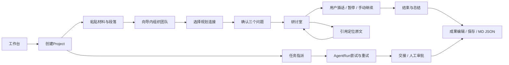

# 信息架构与核心流程
2026-11-08 · 目标架构；原型以八个代表页面演示，不宣称实现所有目标路由。

## 导航树
```text
Workspace 我的研究空间
├─ 工作台：继续研究、项目、近期成果、待处理事项
├─ Projects：研究项目列表（当前原型嵌于工作台）
│  └─ Project
│     ├─ Overview 项目概览
│     ├─ Research Sessions 会话列表 → Research Room（原型每项目一场）
│     ├─ Team 项目成员 → Agent Studio
│     ├─ Tasks 任务 → Assignment / AgentRun / Approval
│     ├─ Materials & Evidence 原文、证据、反向引用
│     ├─ Outputs 成果 → 版本 / 审查 / 导出
│     └─ Activity 项目事件（原型与Tasks同页）
├─ Agents 全局身份库（原型导航进入当前团队代表页）
├─ Materials 全局材料索引（原型展示当前项目）
├─ Outputs 全局成果索引（原型展示当前成果）
├─ Activity 跨项目事件索引（后续真实聚合）
└─ Settings → Model Connections
```
顶层导航回答“进入哪类工作”；项目内导航回答“对当前项目做什么”。禁止用顶层工作台过滤改变Project实际状态。原型跨项目选择会恢复各自材料、会话、成果与任务；机器人身份和连接列表属空间级。生产真实聚合页必须由服务端范围查询生成，不将代表页当成已交付全局索引。

## 三条交互路径

完整Coordinator→任务分解→执行/交接→核验→候选审批→交付契约见[user-workflows.md](user-workflows.md)。下图是现有原型导航路径，不代表已经自主执行。

A/B可操作代码与Alpha机制对应；C完全是未来合成原型。连接选择不触发请求；总结为显式标记的合成文本。原型不支持创建第二场会话，既有会话会转回Room保留记录；真实多Session列表为B05。

## 页面与信息优先级
| hash | 首要对象 / 操作 | 次级上下文 | 布局 |
|---|---|---|---|
| workspace | 项目续接 / 创建 | 团队、活动、待审 | 概览主区 + 侧栏 |
| project | 目标 / 运行会话 | 任务、材料、成果、成员 | 聚合双列，子区两列 |
| team | 成员身份 / 修改 | 职责、连接、权限、工作记录 | 列表 + 详情 |
| room | 讨论与回应关系 / 插话控制 | 团队、材料、证据切换 | 时间线 + 检查器 |
| output | 文档 / 编辑保存导出 | 目录、来源、审阅 | 文档三列，窄屏顺序重排 |
| connections | 连接 / 配置与模拟测试 | 真实返回身份、分配、安全 | 列表 + 配置详情 |
| materials | 段落原文 / 双向引用 | 材料列表、证据类型 | 原文中心的三列 |
| tasks | 工作单元 / 运行尝试 | 活动、交接、人工审批 | 任务表 + 详情，活动分区 |

## 权限与人类介入
当前Alpha是本机单用户，无空间成员认证，不能以未来权限表声称已有RBAC。
目标Workspace拥有者管理连接、预算与团队；Project Membership约束材料和工具范围；Agent获得最小任务范围；Approval只批准特定动作/版本，批准失效后重新请求。读取材料、提出修订与管理其他Agent是不同权限。外发、删除、付款与公开发布不由普通“完成任务”继承。

## 返回与状态保留
来源链接记录Message ID、Material revision、segment ID；反向定位具体消息，不跳列表尾部。编辑草稿独立于已保存成果，导航与刷新保留；导出仅保存版。菜单Escape关闭返回触发器，若触发器因重绘消失则回主要内容。移动导航Escape及外部点击关闭；模型离线保留最后状态和输入，不自动续跑。空/加载/失败不隐藏全局定位和恢复入口。

V1.2保持八页布局。Tasks补工作流蓝图与依赖交接；候选审批显示待应用正文/hash，批准后原样应用。持久Agent身份和连接是阶段2，不能把Studio配置移到阶段3以后。
