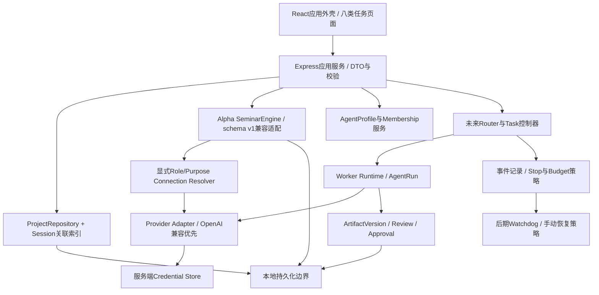

# 技术架构与渐进迁移
2026-11-08。ADR与未来工程约束，本轮只实现独立静态原型。

## 现场基线
本地较新未提交工作版本源码React19/Vite7 + Express/TypeScript；`web/App.tsx`管理单Session，`WorkspaceUI.tsx`已有导航、成员等可复用展示；`server/seminar.ts`负责固定座位调度，`server/llm.ts`默认依赖全局配置；`server/store.ts`按Session JSON保存。`CallLog.model`来自配置而非响应实际身份。不能只换UI标签就宣称多模型生效。

公开main基线与本地较新工作版本分开：本轮设计发布不包含本地未提交生产修复，阶段1入口B01必须先审查并另行同步修复。

本地六项修复由pending/userResponses、host end guard、store interrupted及Room summary轮询等共同落实。新外壳不复制状态机，不将全局路由切换等同于停止任务。

## ADR-01 先外壳与项目真闭环，不重写引擎
阶段1新增Project关联、真实项目列表和项目内会话选择；复用Landing/Setup/Discussion/MaterialPanel/SummaryPanel/Room与WorkspaceUI现有业务处理，只逐步提取展示组件。路由与领域不在组件中重复持久化。第一条真实闭环是创建Project→关联材料/Session→研讨→总结→保存导出。旧Session只读可用，未归档历史不自动批量迁移。

### Sidecar只作过渡与单一真源
阶段1/2限单用户单写入者；sidecar拥有Project及project→session关联。schema-v1 Session JSON拥有原始材料、消息、calls/decisions、stage/summary；Output只读summary并通过原服务写回，禁止另外维护一份可写Artifact正文。索引/列表缓存可重建，不作为第三份真源。每个资源只允许一个Repository写入口，业务代码不能绕过Repository直接写文件。

### 写入、备份与异常恢复（后续实现要求）
1. 写入前验证结构、revision及权限；同一资源/关联串行化；跨进程写入不在sidecar保证范围内，第二写入者必须拒绝或先迁移。
2. 同目录创建独占临时文件，写完整payload并sync文件句柄后关闭，再在支持并验证替换语义的平台rename到目标；保留前一有效generation及校验hash。目录sync支持情况与Windows文件占用失败单独记录，不把rename或普通writeFile声称为任意断电均安全。
3. 关联操作先持久化operationId/intent与旧新revision，执行幂等写入，再记录commit marker。读取未提交关联时隔离并按日志重做/回滚；它是可恢复协议，不是多文件ACID事务。单一会话文件的写入失败保持旧有效generation可读，损坏文件保留隔离，禁止覆盖成空对象。
4. 迁移前暂停写入、导出一致快照、核对文件数量/hash/schema/引用关联；备份放独立目录，先在新目录完成恢复演练。当前Alpha的普通writeFile只有进程内串行，尚未实现以上原子写、断电恢复和备份保证，不能用现有测试冒称通过。
5. 重启仅恢复本地状态/日志，不调用模型；遗留running转中断等人工继续。外部模型完成情况不明时标unknown，不自动重放收费请求。恢复/重新绑定连接都不能清空pending或重复已成功效果。

### 退出条件、迁移与回退
出现并行写入、跨对象提交、复杂任务恢复或频繁关联修复时，提前评估事务Repository。最迟在阶段3首个持久AgentRun前完成B23：默认目标是同机SQLite事务边界，覆盖Project/Task/Run/Version/Approval及事件的原子提交；如选等效方案，必须有相同的崩溃/并发/备份恢复证据。阶段0不安装数据库依赖，不将sidecar无条件固定成永久架构。

迁移流程：冻结旧写入口 → 验证备份 → 导入新库（保留legacySessionId/schema版本映射）→ 校验数量、引用与兼容导出 → 演练恢复 → 切换唯一读写Repository。活动Session及关联一旦切到新库，旧JSON只作不可变迁移源/备份；不双写、不让UI按“哪个文件更新”猜真源。旧导出由兼容序列化器产生，不等于维护第二份可写状态。

切换前失败可恢复旧入口；切换后已有新库写入时，禁止直接启动旧版写旧备份。必须冻结新写入，验证兼容反向导出与更新完整性后回退，或使用新库只读兼容查看。新Task/Version无法无损降级时明确限制回退为只读，保留新库与全部审计，不假装“恢复旧文件”无损。

依据：[Node文件API](https://nodejs.org/api/fs.html)、[SQLite事务原子提交](https://www.sqlite.org/atomiccommit.html)、[SQLite备份](https://www.sqlite.org/backup.html)。这些说明支持设计判断，不证明本项目实现过事务恢复；选定运行时和文件系统后必须实测。

## ADR-02 连接解析成为显式依赖
阶段2建立`resolveConnection(sessionSnapshot,seat,purpose)`，planner/host/a/b/summarizer明确继承与覆盖；调用参数必须传进LLM adapter，不允许仅记录角色配置而继续使用全局模型。默认与覆盖在开始前展示；缺失/禁用连接显式失败，不能偷偷回退。

Adapter统一请求/输出/工具调用/结构化修复/Token/错误/超时，先多个OpenAI兼容连接。原生厂商Adapter另行实测，界面能填写名字不代表支持。配置名与returnedModel分列，缺失返回名用null；调用链记录connectionId、provider、purpose、duration、usageMissing、retry和errorCode。

CredentialStore仅服务端，建议本机OS保护的密钥文件或等效凭据库，优先核实现有运行方式再选实现；前端仅hasCredential，不接收旧密钥。Base URL验证http/https、限制凭据重定向与日志泄漏，SSRF保护按部署模式制定；本机兼容服务采用明确允许策略。HTTP超时/停止信号传递到工具续调、结构修复、重试；预算包含全部调用并预留总结。不配置真实费用则只显示Token，不估造费用。

## ADR-03 持久身份与执行座位分离
阶段2引入Profile与Membership；保留host/a/b作为当前引擎执行座位。Session创建时保存姓名/职责/非敏感模型快照，改名不改历史；跨项目身份复用不继承项目敏感材料。界面显示机器人身份、职责、连接、实际返回模型四个层级，不能混成一个标签。

## ADR-04 任务引擎独立于Alpha循环
阶段3再加入Router/Worker：任务输入refs、验收与依赖→Assignment→AgentRun→结构化交接→下游消费。Router不是无限循环群聊。Run具备不可变输入/执行者快照、attempt、幂等key；成果应用另做去重；恢复先判断已完成效果，不能重放成功调用。失败分类鉴权/限流/超时/结构/引用/预算/取消；只有明确可重试类别可在预算内重试。恢复默认需人工继续，不自动重新花费。

## ADR-05 成果版本先解决冲突再做协同
阶段4版本不可变；基于baseVersion提交patch/suggestion；并发旧版本返回409，不覆盖。Approval绑定targetVersionId/contentHash与动作范围，版本改变失效。任务提交与成果发布分开；用户批准文档不等于批准外部发送。先单写入者+提案审查，再决定是否值得引入CRDT；阶段0不新增富文本、数据库或协同依赖。

## ADR-06 事件与Watchdog后置
阶段5由真实任务事件触发，前台输入与后台执行解耦；事件/任务状态持久化，有租约、心跳和恢复决策；watchdog发现中断只能按停止/预算/权限策略转等待或安全重试，不能绕过人工终止。停止标志持久化且单调生效，重试、工具续调和总结预算均检查。长期记忆为可审阅、可删除、有来源的独立对象，不将所有对话无限共享给Worker。

## 测试及发布门禁
每阶段先记录实际基线；类型、单元、构建、Mock E2E、八页视觉与三尺寸、密钥泄漏/旧数据/终止语义分开验收。真实模型仅在用户启动或额度授权后，至少两个不同国内模型同Session协作；同厂商不同模型与跨厂商分开报告。真实返回身份、指定连接和相互回应必须有证据。阶段1可先发布真实项目闭环；阶段2达到原V0.2 P0后才宣称多模型版本完成。无真实调用时只交付Mock验收，不能标记真实通过。

回滚依靠版本化索引与feature flag、备份、兼容读路由；数据迁移不得依赖前端localStorage重建。任何阶段发现六项回归或历史导出不兼容，停止发布，恢复旧入口并保留新数据待修，不执行破坏性回滚。

## V1.2执行职责与发布范围
Coordinator负责目标/计划/整合，Router负责按依赖与策略调度；Worker执行Task。完整协议以user-workflows.md为准。多模型与Profile/Membership同属阶段2；阶段3才建设自主Task引擎，阶段4系统化证据审查和共同写作，阶段5持久自主运行。当前发布只含设计/原型，不实施上述存储协议、连接层或数据库。
