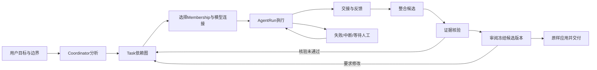

# AI团队工作流与用户监督契约 · V1.2
2026-11-08。本文件定义未来引擎应实现的完整链路。独立原型只演示合成任务/候选交接，不宣称自主执行已实现。八页位置见[information-architecture.md](information-architecture.md)。

## 主链路、输入与交接

| 步骤 | 责任 / 输入 | 可持久化输出 | 用户观察与介入 | 阶段 |
|---|---|---|---|---|
| 1 提出目标 | 用户；目标、材料、范围、预算/停止条件 | Project goalRevision、交付结构与验收标准 | 修改目标、决定材料发送范围 | 1基础；3完整约束 |
| 2 分析与拆分 | Coordinator；读取目标/已有成果/材料与权限 | 带revision的Task图：目标、依赖、所需技能、输入refs、验收标准 | 查计划与理由，调整范围；改变计划不覆盖在途输入 | 3 |
| 3 选择与分工 | Router按职责/能力/预算匹配Membership与Connection | TaskAssignment、权限边界、Run执行/模型快照 | 看谁负责、调用何连接；不能静默换模型 | 2身份与连接；3动态调度 |
| 4 执行 | Worker；冻结目标版本、材料revision、上游交接refs | AgentRun、工具/调用记录、checkpoint | 具体状态/错误/当前活动；可暂停、取消、补充要求 | 3 |
| 5 交接与反馈 | Worker提交；下游显式接收或退回 | Handoff：sourceRunId、outputRefs、evidenceRefs、assumptions、unresolved、acceptance结果 | 看上游输入怎样被消费；退回有理由 | 3 |
| 6 整合 | Coordinator/Writer消费已接收交接 | 候选ArtifactVersion；明确每项结论来自何材料/推断 | 看差异、保留分歧、要求补充 | 3基本候选；4共同修订 |
| 7 核验 | Verifier独立检查原文/主张/冲突与引用 | EvidenceVerification与ReviewFinding；阻塞项未解决不请求最终批准 | 区分逐字匹配、事实支持程度与模型推断 | 3最小原文核对；4系统审查 |
| 8 人工批准 | 用户审阅**冻结候选正文**、targetVersionId与contentHash | Approval：版本/内容hash/动作范围/意见 | 接受、要求修改、拒绝；基线变化使批准失效 | 3最小批准；4版本审查 |
| 9 交付 | 应用已批准候选，导出保存内容 | 已交付ArtifactVersion与可追溯manifest | 检查版本/来源；外发另行授权 | 1保存导出；3/4受审交付 |

## 依赖与运行状态
Task有且仅有一个Project；可关联多个Session但不能依赖Session寿命。前置结果被接收后依赖才满足，创建Task不等于立即调度。依赖图不得成环；计划修改新增revision，不偷偷改已开始Run的输入。Agent数量来自团队成员和任务需求，不写死三个角色；当前Alpha的host/a/b仅为兼容座位。

Task目标状态：blocked → ready → running → waiting_review → completed；失败为failed，等待用户可waiting_input，退回为needs_revision，终止为cancelled。Run尝试：queued → running → succeeded / failed / cancelled / interrupted。Run成功只表示本次执行提交成功，不自动意味着Task验收通过或Artifact已批准。

## 失败恢复与人工介入

| 事件 | 必须行为 | 禁止行为 |
|---|---|---|
| 超时/限流/可修复结构错误 | 分类、记录尝试；在预算内按策略重试，失败保留输入/交接 | 无限重试或切到未指定收费连接 |
| 进程中断 | Run标记interrupted，冻结已提交效果；默认等待用户继续 | 读取历史时自动调用、覆盖旧尝试 |
| 部分成功 | 保留已接收交接，只重试未完成工作 | 重新运行成功Worker或重复应用成果 |
| 用户插话/新材料 | 追加事件；Coordinator评估是否修订计划；在途Run保留原输入快照 | 静默改正在执行的输入并复用旧批准 |
| 暂停 | 停止新调度，说明在途请求可能完成 | 把暂停理解成取消或屏蔽错误 |
| 终止 | 持久stop信号贯穿Router/Worker/工具/修复/重试；日志可见 | 后台恢复绕过终止，自动多花额度 |
| 证据不足/核验失败 | 标明推断/不足；退回具体Task或请求材料 | 用多Agent共识替代证据 |
| 用户要求修改 | Approval拒绝/失效，Task转needs_revision，新Run保留旧候选 | 批准旧稿后另生成未审新稿 |

幂等分两层：commandId防止同一开始命令创建多个Run；Run成功交接应用用outputRef+targetBaseVersion去重。重试是新attempt；系统不承诺外部模型exactly-once调用，无法判断远端请求是否完成时记unknown并由用户决定，不能假装重试绝无重复费用。

## 可验收的最小自主协作（阶段3门禁）
相同目标下，Coordinator产生至少两个有依赖/可解释分工的Task；由不同持久Agent执行，后续Run实际读取上游交接并反馈；一次失败恢复不重复已成功效果；用户插话改变下一步；关键结论有原文或推断标记；用户审阅候选，最终内容与批准hash完全一致。日志能关联Project→Task→Assignment→Run→Handoff→Evidence→ArtifactVersion→Approval。
不同模型真实调用是阶段2的必要验收，但单独完成它不满足以上阶段3门禁。阶段2无额度时保持真实验收待完成，不得将任务挪到阶段5后宣布多模型已完成。

## 原型路径与覆盖程度
A从目标到固定三角色研讨；B从引文到保存导出；C从指派/失败/重试到依赖交接、候选正文审阅并原样应用。Tasks的“工作流蓝图”展示完整目标链。C中所有执行由人点击演示，Coordinator自主分析与自动调度仍属规划。保持这种边界，避免用动画或轮流发言冒充自主工作流。
